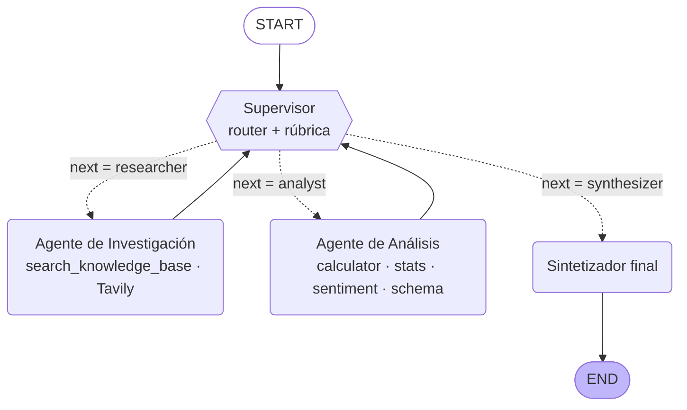

# 🧭 Orquestador Multi-Agente de Análisis e Investigación (LangGraph)

Prototipo de **topología jerárquica con Supervisor**: un nodo router inteligente delega en dos
especialistas (Investigación y Análisis), valida sus resultados con una **rúbrica** y recién entonces
habilita la **síntesis final**.

## 🗺️ Diagrama del grafo



> Las líneas punteadas son **aristas condicionales**. También se puede regenerar desde el propio grafo:
> `python main.py --diagram` → `docs/graph.mmd` (offline) y `docs/graph.png` (usa
> `graph.get_graph().draw_mermaid_png()`, requiere internet).

## 📁 Estructura

```
.
├── state.py                  # OrchestratorState (hereda de MessagesState) + Contribution
├── supervisor.py             # Nodo supervisor, rúbrica, guardarraíles y función de ruteo (Literal)
├── graph.py                  # StateGraph: nodos, aristas condicionales, compile()
├── main.py                   # CLI de demo (muestra la delegación paso a paso)
├── config.py                 # MAX_STEPS, MAX_REFINEMENTS, selección de LLM
├── agents/
│   ├── research_agent.py     # Especialista de búsqueda (create_react_agent)
│   ├── analyst_agent.py      # Especialista de análisis/cómputo (create_react_agent)
│   ├── synthesizer.py        # Fase de síntesis final
│   └── utils.py              # Contexto aislado por agente
├── tools/
│   ├── research_tools.py     # Vector DB simulada + Tavily (opcional)
│   └── analysis_tools.py     # calculadora segura, estadísticas, sentimiento, validación de esquema
├── data/knowledge_base.py    # Base de conocimiento simulada (reemplazable por tu Vector DB)
├── tests/                    # Tests offline de herramientas y guardarraíles
├── demo.ipynb                # Notebook de demostración del flujo de delegación
└── docs/graph.mmd            # Diagrama exportado
```

## ⚙️ Instalación y ejecución

```bash
python -m venv .venv && source .venv/bin/activate      # Windows: .venv\Scripts\activate
pip install -r requirements.txt
cp .env.example .env                                   # completar la key del proveedor elegido
python main.py                                         # consulta de demo
python main.py "tu consulta propia"
pytest -q                                              # tests offline
```

### 🔀 Proveedor de LLM

Se elige con variables de entorno, sin tocar código (`config.get_llm()`):

| `LLM_PROVIDER` | Key requerida | `LLM_MODEL` por defecto |
|---|---|---|
| `openai` | `OPENAI_API_KEY` | `gpt-4o-mini` |
| `anthropic` | `ANTHROPIC_API_KEY` | `claude-sonnet-4-5` |
| `gemini` | `GOOGLE_API_KEY` | `gemini-3.5-flash-lite` |

```bash
LLM_PROVIDER=gemini python main.py
```

`TAVILY_API_KEY` es **opcional**: sin ella el Investigador usa solo la base de conocimiento simulada.

## 🧱 Estado compartido (`state.py`)

| Campo | Tipo | Para qué sirve |
|---|---|---|
| `messages` | `MessagesState` | Hilo de conversación (aportes etiquetados con `name=`) |
| `next_agent` | `str` | Destino de la arista condicional (lo escribe el Supervisor) |
| `current_instruction` | `str` | Instrucción **específica** para el próximo especialista |
| `step_count` | `int` | Contador de pasos → condición de parada |
| `contributions` | `list[Contribution]` *(reducer `operator.add`)* | **Quién aportó qué**: `step`, `agent`, `instruction`, `output`. Acumula, nunca pisa |
| `supervisor_notes` | `list[str]` *(reducer `operator.add`)* | Auditoría de decisiones y validaciones |
| `research_findings` / `analysis_results` | `str` | Última salida vigente de cada dominio |
| `task_completed` / `final_answer` | `bool` / `str` | Cierre de la tarea |

## 🧠 ¿Por qué esta topología? (Supervisor jerárquico)

- **Control centralizado**: un único nodo decide el flujo, así que hay un solo lugar donde aplicar la
  rúbrica de calidad y la condición de parada. En una topología en red/peer-to-peer cada agente decidiría
  a quién llamar y sería mucho más difícil garantizar que el proceso termine.
- **Dependencia natural entre dominios**: el análisis necesita los datos de la investigación; el
  supervisor garantiza ese orden y puede *volver atrás* si los datos no alcanzan.
- **Escalable**: sumar un especialista = un nodo nuevo + una opción en el `Literal` + una línea en el prompt.
- **Los especialistas siempre devuelven el control al Supervisor**, que es quien valida antes de `END`.

## 🧪 Validación: rúbrica del Supervisor

Antes de elegir `synthesizer`, el prompt del supervisor exige verificar: **(1) Cobertura**, **(2) Evidencia con
fuente**, **(3) Cálculos respaldados por herramientas**, **(4) Consistencia** investigación↔análisis y
**(5) Suficiencia**. El resultado de cada chequeo queda registrado en `supervisor_notes`.

## ⚔️ Manejo de conflictos entre agentes

1. **Jerarquía de autoridad por dominio**: para *datos* manda el Investigador; para *cálculos e interpretación*, el Analista.
2. **Contradicciones**: si el análisis no coincide con los datos (p. ej. usa 10 reseñas y se reportaron 8), el supervisor
   reenvía al responsable citando la inconsistencia concreta.
3. **Datos insuficientes**: el Analista tiene instrucción de responder `DATOS_INSUFICIENTES:` y explicar qué falta;
   el supervisor lo devuelve al Investigador con ese feedback.
4. **Última palabra**: ningún especialista puede cerrar la tarea; solo el supervisor habilita al sintetizador.

## 🛡️ Errores comunes evitados

| Riesgo | Mitigación implementada |
|---|---|
| **Supervisor infinito** | `MAX_STEPS` (default 8) + `MAX_REFINEMENTS` (default 1 por especialista) aplicados por `apply_guardrails()` **en código**, no solo en el prompt. Al alcanzar el límite se sintetiza con lo disponible y se informa la limitación. Además `recursion_limit` en la ejecución |
| **Contaminación de contexto** | Cada especialista se invoca con un contexto **aislado**: solo su instrucción (+ los datos del investigador en el caso del analista, + su propia salida previa si refina). No ve el historial completo ni la metadata del sistema |
| **Saltos inválidos** | Guardarraíles: el analista no corre sin datos; no se finaliza sin que hayan intervenido ambos dominios |
| **Fallas temporales del proveedor** (503/429/timeouts) | `RetryPolicy` con backoff exponencial en cada nodo (`graph.py`, solo errores transitorios; los errores de config/código no se reintentan) |
| **Cuota diaria agotada** (plan gratuito) | No se reintenta (falla rápido). Una corrida usa ~10-20 llamadas al LLM: cambiá de modelo/proveedor o activá facturación |
| **Pérdida de contexto** | `contributions` con reducer acumulativo: trazabilidad completa de quién aportó qué y cuándo |

## 🎬 Demo

Consulta de ejemplo que fuerza la secuencia **Supervisor → Investigador → Supervisor → Analista → Supervisor → Síntesis**:

> *"Investiga las reseñas de clientes de los auriculares AuraPods en la base de conocimiento, analiza el sentimiento de cada
> reseña y calcula el porcentaje de reseñas positivas y la calificación promedio."*

Ejecutá `python main.py` o abrí `demo.ipynb`. Una ejecución real documentada (flujo, trazabilidad, decisiones del supervisor y verificación de cifras) está en [`docs/ejemplo_ejecucion.md`](docs/ejemplo_ejecucion.md). Con los datos de la base simulada, el análisis debería arrojar
~60 % de reseñas positivas y una calificación promedio de 3.5/5 (las cifras exactas de sentimiento dependen de la
herramienta léxica; los valores de referencia están cubiertos en `tests/`).

## 🔌 Conectar tu Vector DB de pre-entregas anteriores

En `tools/research_tools.py`, reemplazá el cuerpo de `search_knowledge_base` por:

```python
docs = vectorstore.similarity_search(query, k=top_k)
return "\n\n".join(f"[fuente: {d.metadata.get('id','?')}] {d.page_content}" for d in docs)
```
