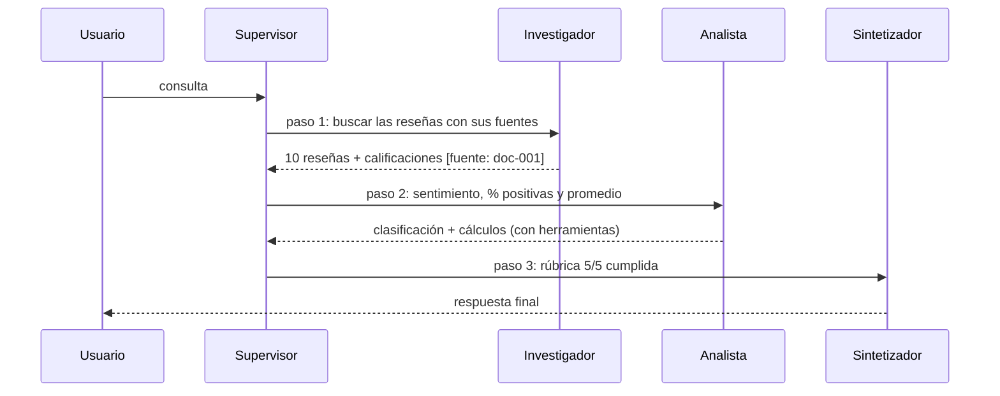

# 🎬 Ejemplo de ejecución real

Evidencia del flujo de delegación del orquestador, ejecutado desde `demo.ipynb`.

- **Proveedor / modelo:** Gemini — `<gemini-3.5-flash-lite...>`
- **Consulta:**
  > Investiga las reseñas de clientes de los auriculares AuraPods en la base de conocimiento, analiza el sentimiento de cada reseña y calcula el porcentaje de reseñas positivas y la calisficación promedio.
- **Resultado:** 3 pasos del supervisor · `task_completed = True`

## 🔀 Flujo observado



## 🧾 Trazabilidad (`state["contributions"]`)

| Paso | Agente | Instrucción recibida (resumen) |
|---|---|---|
| 1 | `researcher` | Buscar en la base de conocimiento todas las reseñas disponibles de los auriculares AuraPods |
| 2 | `analyst` | Tomar las 10 reseñas del investigador, analizar el sentimiento individual y calcular el porcentaje de positivas y la calificación promedio |

El sintetizador no figura en `contributions` a propósito: esa lista registra solo a los especialistas.

## 🧠 Decisiones del Supervisor (`state["supervisor_notes"]`)

| Paso | Decisión | Validación con la rúbrica |
|---|---|---|
| 1 | → `researcher` | N/A (aún no hay resultados). Inicio: delegar la búsqueda de datos crudos |
| 2 | → `analyst` | Cobertura parcial (falta análisis) · Evidencia: cumple (10 reseñas con fuente) · Suficiencia: **No** |
| 3 | → `synthesizer` | Cobertura completa · Evidencia con `doc-001` · Cálculo correcto (3.5 y 60 %) · Consistente (10 reseñas en ambos pasos) · Suficiencia: **Sí** |

Se observa que el supervisor **no finaliza hasta que la rúbrica se cumple**: en el paso 2 la marcó como insuficiente y recién en el paso 3 habilitó la síntesis.

## ✅ Respuesta final del Sintetizador

> Formato LaTeX de la salida original reemplazado por texto plano para legibilidad.

**1. Respuesta directa y análisis de sentimiento**

Se analizaron 10 reseñas de clientes. El porcentaje de reseñas positivas es del **60.0 %** y la calificación promedio es de **3.5 sobre 5**.

- **R1** (5/5): "Excelente sonido, la batería dura todo el día. Totalmente recomendable." → **Positivo** [fuente: doc-001]
- **R2** (4/5): "Muy buena calidad de audio, aunque el estuche es un poco grande." → **Positivo** [fuente: doc-001]
- **R3** (2/5): "La conexión bluetooth es mala y se corta seguido. Decepcionante." → **Negativo** [fuente: doc-001]
- **R4** (5/5): "Cómodos y livianos, la cancelación de ruido es increíble." → **Positivo** [fuente: doc-001]
- **R5** (1/5): "Llegaron defectuosos, el auricular izquierdo no funciona. Pésimo servicio." → **Negativo** [fuente: doc-001]
- **R6** (4/5): "Buen producto por el precio, la batería es buena." → **Positivo** [fuente: doc-001]
- **R7** (3/5): "Sonido correcto, nada especial. El micrófono es regular." → **Neutral** [fuente: doc-001]
- **R8** (5/5): "Me encantan, el mejor producto que compré este año." → **Positivo** [fuente: doc-001]
- **R9** (2/5): "Incómodos para usar mucho tiempo, se caen al correr." → **Negativo** [fuente: doc-001]
- **R10** (4/5): "Excelente relación calidad precio, los recomiendo." → **Positivo** [fuente: doc-001]

**2. Datos clave y cifras**

- Distribución de sentimientos (sobre 10 reseñas): 6 positivas (60.0 %), 1 neutral (10.0 %), 3 negativas (30.0 %)
- Estadísticas de calificación: n = 10 · suma = 35 · promedio = **3.5** · mediana = 4 · mín/máx = 1/5 · desvío estándar poblacional = 1.3601

**3. Fuentes citadas**

- **doc-001**: contiene las reseñas R1 a R10 de los auriculares AuraPods.

## 🔍 Verificación independiente de las cifras

Las cifras se contrastaron con un cálculo aparte sobre los mismos datos de la base:

| Dato | Obtenido | Esperado |
|---|---|---|
| Positivas / neutrales / negativas | 6 / 1 / 3 | 6 / 1 / 3 |
| % de reseñas positivas | 60.0 % | 60 % |
| Suma y promedio de calificaciones | 35 y 3.5 | 35 y 3.5 |
| Mediana | 4 | 4 |
| Mínimo y máximo | 1 y 5 | 1 y 5 |
| Desvío estándar poblacional | 1.3601 | 1.3601 |

## ▶️ Cómo reproducirlo

```bash
python main.py                     # consulta de reseñas (la de este ejemplo)
python main.py "Compara AuraPods con SonicBuds y PulseAir: investiga precio, bateria y calificacion de cada uno, calcula el precio por hora de bateria de cada uno, y las ventas totales de AuraPods en 2025 con su margen bruto en USD y en porcentaje."
```

O ejecutá `demo.ipynb` de arriba hacia abajo (con el kernel del `.venv`).
